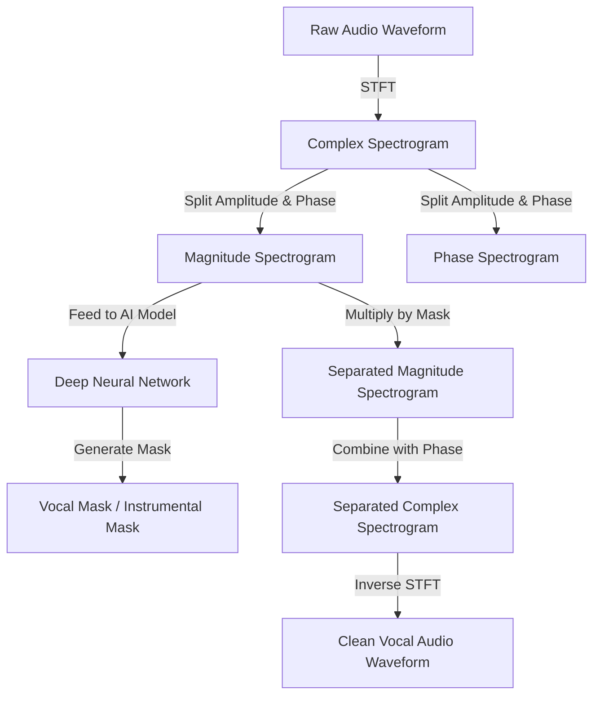

# Deep Technical Analysis: How VocalRemover.org Works

This report provides a comprehensive breakdown of the science, deep learning models, software architecture, and engineering stack that power **VocalRemover.org** and modern AI-driven music source separation services.

---

## 1. Executive Summary

**VocalRemover.org** is a popular web-based utility designed to split audio tracks into individual stems (e.g., vocals, instrumentals, drums, bass). Historically, vocal removal relied on simple DSP (Digital Signal Processing) tricks like phase cancellation, which severely degraded audio quality. Modern platforms use **Deep Neural Networks (DNNs)** trained on vast datasets of multi-track audio to isolate components with high fidelity.

The service operates on a **hybrid client-server architecture**:
*   **Client-Side (Browser):** Handles file uploading, UI state, playback, and lightweight DSP utilities (e.g., client-side pitch shifting and visualizers using the Web Audio API).
*   **Server-Side (Cloud/GPU Cluster):** Executes deep learning model inference (typically written in PyTorch or optimized using ONNX Runtime) to perform the computationally intensive source separation.

---

## 2. The Science: Audio Representation & Source Separation

To understand how the AI isolates vocals, we must look at how digital audio is represented and processed.



### Waveform vs. Spectrogram
Digital audio is stored as a **waveform**—a sequence of amplitude values over time. While waveforms are great for playback, they are highly complex and contain overlapping frequencies, making them difficult for a neural network to parse directly.

To solve this, audio is converted into a **spectrogram** using the **Short-Time Fourier Transform (STFT)**:
1.  **Windowing:** The audio signal is sliced into short, overlapping segments (e.g., 2048 samples, ~46ms).
2.  **Fourier Transform:** A Fast Fourier Transform (FFT) is applied to each segment to extract its frequency components.
3.  **Visual Matrix:** The result is a 2D grid representing **time** (x-axis), **frequency** (y-axis), and **amplitude/magnitude** (color intensity/value).

### The Concept of "Masking"
Instead of generating brand-new audio from scratch, most frequency-domain separation models predict a **mask** (a matrix of values between 0 and 1) that is multiplied element-wise with the original mixture's spectrogram.
*   **Binary Mask:** A pixel is either 1 (vocal) or 0 (noise/instrument). This often sounds blocky and artificial.
*   **Soft/Ratio Mask (Wiener Filtering):** A pixel is a continuous value between 0 and 1, representing the probability or ratio of the vocal signal at that specific time and frequency. This produces smooth, natural-sounding results.

Once the separated magnitude spectrogram is obtained via masking, it is combined with the original mix's **phase** information and converted back to a raw waveform using the **Inverse STFT (iSTFT)**.

---

## 3. Deep Learning Model Architectures

While VocalRemover.org is proprietary and does not publish its exact model weights, it utilizes architectures similar to those developed by major AI research labs and open-source groups. The field has evolved through three major architectural eras:

### A. Spectrogram-Based Convolutional Networks (U-Net)
Originally popularized by Deezer's **Spleeter** (2019), this approach treats audio separation as an image-segmentation task.
*   **How it works:** A 2D Convolutional U-Net takes the magnitude spectrogram of the audio mix. The encoder contractively extracts high-level acoustic features, while the decoder expands it back to the original spectrogram size, predicting the masks for vocals and instrumentals. Skip connections preserve spatial and temporal alignment.
*   **Limitation:** It struggles to capture long-range musical context and can introduce "phase smear" since it discards phase information during processing.

### B. Waveform-Based Temporal Networks (Demucs)
Developed by Meta AI, **Demucs** processes raw audio waveforms directly in the time domain without requiring an explicit STFT step.
*   **How it works:** It uses a 1D U-Net structure combined with a sequence-modeling layer (like a Bidirectional LSTM) between the encoder and decoder. 
*   **Advantages:** By working in the time domain, Demucs avoids phase reconstruction artifacts, yielding punchy drums, cleaner bass, and natural transient details.

### C. Hybrid Transformers (MDX-Net, HTDemucs, RoFormer)
The current state-of-the-art (SOTA) standard uses **Transformers** to capture both local convolutional features and long-range self-attention relationships.
*   **MDX-Net / HTDemucs:** These hybrid models apply multi-head self-attention over spectrogram grids or time-series waveforms. This allows the AI to "remember" that a vocal harmony occurring at 1:30 has a similar timbre to the vocal at 0:15, leading to incredibly clean separations, even when vocals overlap with complex synthesizers or guitar solos.

---

## 4. VocalRemover.org System Architecture

Building a scalable web service around deep learning inference requires a robust cloud infrastructure. The conceptual stack is structured as follows:

### Conceptual Architecture
```
[ User Browser ] 
       │
       ▼ (HTTPS Upload / WebSocket Status)
[ Web Server & Load Balancer (Nginx / Cloudflare) ]
       │
       ▼
[ API Gateway / Backend Service (Python / FastAPI) ]
       │
       ├─► [ Task Queue (Celery / RabbitMQ / Redis) ]
       │          │
       │          ▼
       │     [ Worker Nodes (GPU Server Pool) ]
       │          │
       │          ├─► Runs Model Inference (PyTorch / ONNX Runtime)
       │          └─► Outputs Audio Stems (.wav / .mp3)
       │
       ▼
[ Cloud Storage / Object Storage (S3 / MinIO) ] ◄── (Saves Stems)
       │
       ▼ (Secure temporary download link)
[ User Browser ]
```

### The Tech Stack Components

#### 1. Frontend Client
*   **UI/UX:** Built with a modern, responsive single-page framework (likely React) styled with clean CSS, dark themes, and drag-and-drop file inputs.
*   **Web Audio API:** Used to render interactive wave visualizers, handle multi-track audio playback (allowing users to solo/mute vocals or instrumentals in real-time), and apply fast, client-side gain/pan controls.
*   **Client-Side Processing (Auxiliary Tools):** 
    *   **Pitch/Tempo Changer:** Likely implements algorithms like WSOLA (Waveform Similarity Overlap-and-Add) or uses a WebAssembly compiled library (such as SoundTouchJS) to perform pitch shifting directly in the browser without uploading the file again.
    *   **Key / BPM Finder:** Extracts spectral features and applies chromagram matching client-side or during the server upload pipeline to detect the musical key and tempo.

#### 2. Backend & Task Queue
Deep learning inference takes several seconds (or minutes) to execute, making synchronous HTTP requests impractical.
*   **Asynchronous Processing:** When a file is uploaded, the backend (e.g., Python using **FastAPI** or **Django**) assigns a unique task ID, saves the file to disk/object storage, and pushes a job to a message broker (**Redis** or **RabbitMQ**).
*   **Task Queue:** **Celery** workers pick up the task and route it to an available GPU worker.
*   **WebSockets:** The client establishes a WebSocket connection to receive live progress updates (e.g., "Uploading...", "Processing 45%...", "Generating files...").

#### 3. Inference Engine
*   **Framework:** **PyTorch** is the standard research framework, but for production, models are often compiled to **ONNX (Open Neural Network Exchange)** format or optimized with **TensorRT** to run 2x-5x faster on NVIDIA GPUs.
*   **Audio I/O:** Libraries like **Librosa**, **ffmpeg**, or **Torchaudio** handle audio decoding, downsampling (typically to 44.1kHz or 32kHz mono/stereo, depending on what the model was trained on), and encoding the output stems to WAV or MP3.

---

## 5. Open-Source Alternatives & DIY Implementation

If you want to run these separation models locally for free, without server queues or file-size limits, the open-source community is highly active.

### Ultimate Vocal Remover 5 (UVR5)
[Ultimate Vocal Remover](https://github.com/Anjok07/ultimatevocalremovergui) is the gold standard desktop GUI application for source separation. It packages all SOTA models (MDX-Net, VR Architecture, Demucs, and ensemble models) into an easy-to-use desktop app that runs locally on Windows, macOS, and Linux.

### Building a Local Python Separator
You can run audio separation in Python using the `audio-separator` library, which utilizes ONNX Runtime to execute MDX-Net and Demucs models.

#### Installation
```bash
pip install audio-separator[gpu]
```

#### Python Implementation Code
```python
from audio_separator.separator import Separator

# Initialize the separator
# It automatically downloads model files and uses GPU if available
separator = Separator()

# Load a specific SOTA model (e.g., MDX-Net model for vocals/instrumental)
separator.load_model(model_filename='Kim_Vocal_1.onnx')

# Perform separation
output_files = separator.separate('my_song.mp3')

print(f"Separation complete! Output files: {output_files}")
# Typically returns: ['my_song_(Vocals).wav', 'my_song_(Instrumental).wav']
```

---

## 6. Comparison of Leading Architectures

| Feature / Model | U-Net (e.g., Spleeter) | Time-Domain (e.g., Demucs v4) | Hybrid Transformer (e.g., HTDemucs / RoFormer) |
| :--- | :--- | :--- | :--- |
| **Domain** | Frequency-domain (Spectrogram) | Time-domain (Raw Waveform) | Hybrid (Time + Frequency) |
| **Inference Speed** | Very Fast (Runs well on CPU) | Moderate (Requires GPU) | Slow (Heavy GPU load) |
| **Separation Quality**| Medium (Can sound robotic/muddy)| High (Great transients and dynamics) | Very High (SOTA clarity, minimal bleed) |
| **Phase Accuracy** | Distorted (iSTFT approximation) | Perfect (No phase loss) | Exceptional (Hybrid reconstruction) |
| **Best Used For** | Real-time / low-power apps | Standard stem-splitting | Professional audio remastering |
